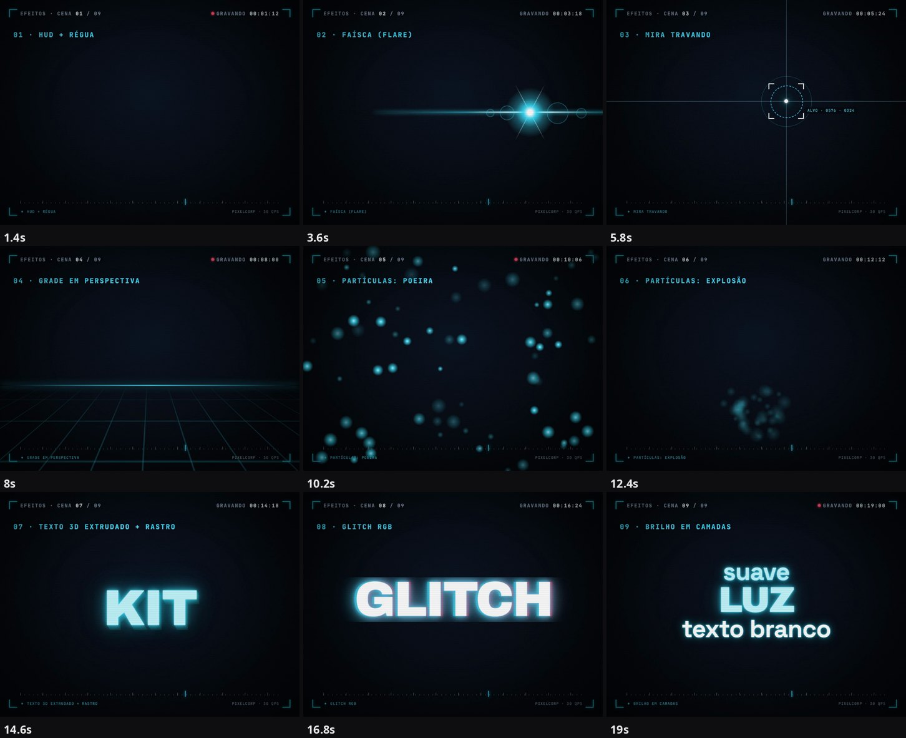
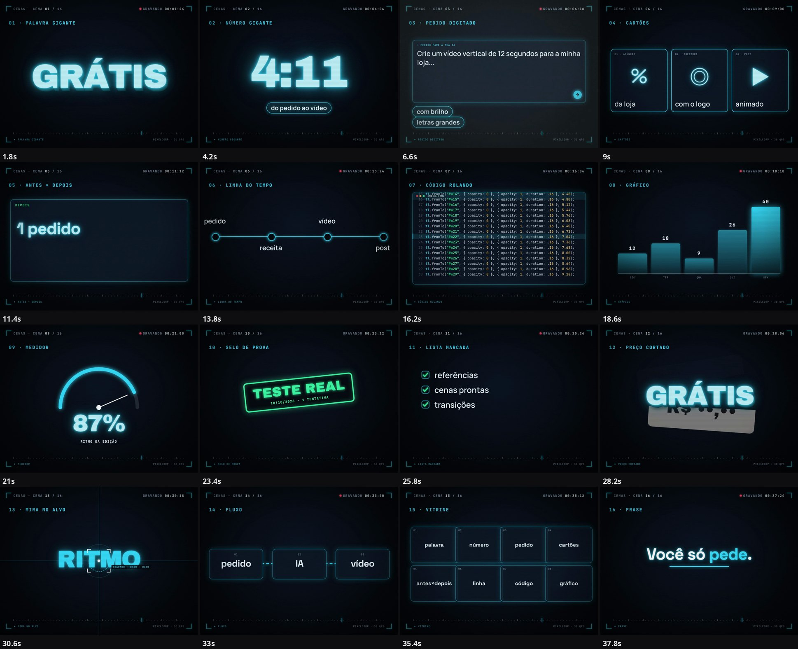
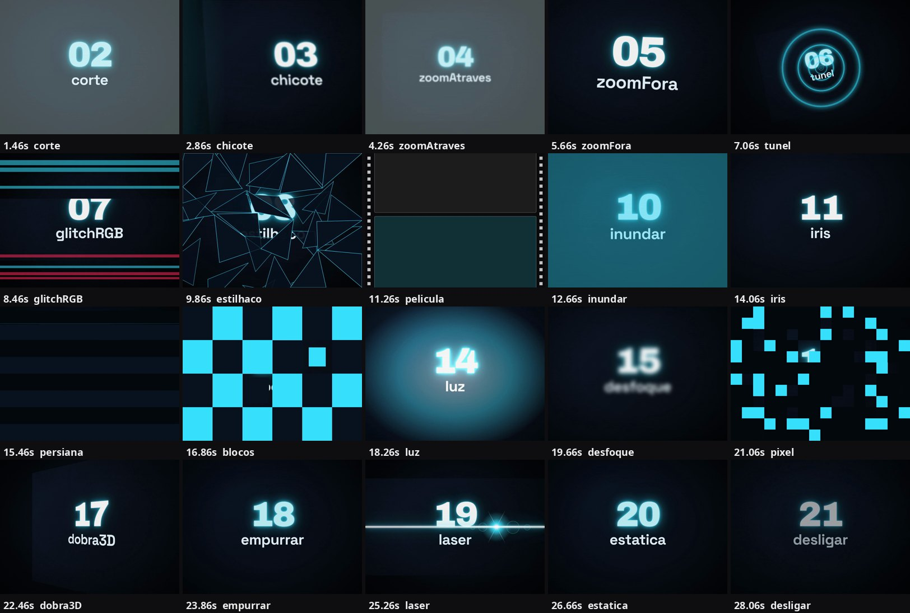

# PixelCorp Motion

**Kit Motion da PixelCorp: o mesmo kit de animação que usamos nos vídeos do nosso canal e nas nossas divulgações, de graça para você.** Sem imagens, sem programa de edição: só a sua IA, com um pedido em português.

Brilho em camadas, faíscas, mira, HUD, grade em perspectiva, partículas, texto 3D, transições que distorcem a imagem de verdade (estilhaço, túnel, glitch, chicote, derreter, inundar) e cenas prontas. Tudo escrito em código (HTML, CSS e JavaScript) para o [HyperFrames](https://github.com/heygen-com/hyperframes), sem custo por vídeo.



## Para que serve

- Anúncio animado de oferta, lançamento, antes e depois, lista de dicas, número que impressiona, abertura com o seu nome.
- Vídeos verticais (reels, shorts, TikTok), 1080×1920, 30 quadros por segundo.
- Quem usa: dono de negócio, criador de conteúdo, agência, qualquer pessoa que já usa uma IA que mexe no computador (como o Claude Code).

Foi testado de ponta a ponta em 18/10/2026: numa conversa nova do Claude Code com o Opus 5.5, só com os arquivos deste kit e um pedido de poucas linhas, saiu um vídeo de barbearia (fictícia) em 9 min 46 s, em uma tentativa, sem retoque.

## Como usar (3 passos, só colando pedidos na sua IA)

Você precisa de **uma IA que trabalha no seu computador**, como o [Claude Code](https://claude.com/claude-code) (plano pago do Claude). O resto a sua IA instala: você só cola três pedidos e aprova o que ela pedir.

**1. Peça para a sua IA instalar o necessário (uma vez):**
> Quero criar vídeos animados com o HyperFrames. Verifique se o meu computador já tem o Node (versão 22 ou mais nova), o ffmpeg e o HyperFrames, e instale o que faltar, passo a passo, explicando tudo em português simples. Pergunte antes de mudar qualquer coisa.

**2. Peça para ela baixar o kit deste repositório:**
> Baixe o Kit Motion da PixelCorp do repositório https://github.com/ivanlessa1986/Pixelcorp-motion (pode clonar ou baixar o ZIP). Crie uma pasta nova chamada meu-video, rode o arquivo kit/baixar-gsap.sh e copie para essa pasta os arquivos kit/kit-motion.md e kit/kit-fx.js. Depois me diga que está tudo pronto.

**3. Cole o pedido do vídeo** (veja outros em [`kit/PEDIDOS.md`](kit/PEDIDOS.md); troque o que está entre [colchetes]):
> Leia o arquivo kit-motion.md desta pasta antes de começar e use o kit-fx.js que está junto. Crie um vídeo vertical de 15 segundos para o meu negócio, [NOME], com a oferta: [OFERTA]. Use o tema escuro neon. Grave em MP4 e me mostre o vídeo em quadros para eu conferir.

<details><summary>Para quem prefere o terminal (opcional)</summary>

```bash
git clone https://github.com/ivanlessa1986/Pixelcorp-motion.git
bash Pixelcorp-motion/kit/baixar-gsap.sh        # baixa o GSAP (biblioteca de animação, gratuita)
mkdir meu-video && cd meu-video
cp ../Pixelcorp-motion/kit/kit-motion.md ../Pixelcorp-motion/kit/kit-fx.js .
```
</details>

É um **pedido**, não uma skill nem um programa: a IA lê o guia (`kit-motion.md`), aprende os valores certos (tipografia, grade, ritmo, curvas, paleta, brilho) e escreve a animação. Sem o guia, ela entrega o básico; com ele, o vídeo sai com cara de profissional.

> **Confira o vídeo inteiro antes de publicar.** A IA pode errar um preço, um nome ou inventar uma frase que você não pediu. Quem publica é você.

## O que vem no kit

| Arquivo | O que é |
|---|---|
| [`kit/kit-motion.md`](kit/kit-motion.md) | O guia que a IA lê antes de animar: as 7 regras que mais mudam o resultado, tipografia, grade e zonas seguras, ritmo, curvas de movimento, 4 temas de cor, sistema de brilho, catálogo de cenas e de transições |
| [`kit/kit-fx.js`](kit/kit-fx.js) | Efeitos prontos com distorção real da imagem: estilhaço, túnel, glitch RGB, chicote com borrão, derreter, inundar, brilho real, fundos animados, partículas, texto 3D, mini-gráficos e medidores |
| [`kit/PEDIDOS.md`](kit/PEDIDOS.md) | Pedidos prontos em português para copiar e colar (oferta, lançamento, antes e depois, abertura, dicas, número, vitrine de efeitos, ajustes) |
| [`kit/kit.mjs`](kit/kit.mjs) | Biblioteca em Node: palco, temas, cenas, iceberg e transições, para montar composições por código |
| [`kit/filmar.mjs`](kit/filmar.mjs) | Passe "filmar a tela": brilho de tela real, aberração cromática, moiré, ruído, curvatura |
| [`kit/mosaico.mjs`](kit/mosaico.mjs) | Mosaico de quadros em instantes exatos, para conferir o vídeo e comparar versões |
| `kit/fontes/` | Fontes livres (OFL) usadas pelo kit |

**4 temas** (escuro neon, escuro ouro, magenta, claro), **17 cenas** modelo e **20 transições**.




## Ajustes depois de pronto

Cole na mesma conversa, por exemplo: "deixe as letras maiores e o vídeo 2 segundos mais curto", "troque o tema para o claro", "troque a transição do meio por um túnel de luz", "mostre o vídeo em quadros para eu conferir".

## Limites honestos

- Precisa de uma IA que rode comandos no seu computador; em um chat comum, sem acesso aos seus arquivos, não funciona.
- O tempo e a qualidade dependem do modelo, do pedido e do computador (renderizar vídeo usa bastante processador e memória; rode um vídeo por vez).
- Não escolhe o melhor take, não edita vídeo longo gravado e não substitui um editor quando o trabalho pede olhar humano.
- Os resultados são gerados por IA: revise textos, números e nomes.

## Licença

[MIT](LICENSE): de graça para você usar, inclusive comercialmente, com a menção ao autor. As fontes em `kit/fontes/` seguem a licença de cada autor (ver [`kit/fontes/LICENCAS.md`](kit/fontes/LICENCAS.md)). O GSAP não é redistribuído aqui: o script `kit/baixar-gsap.sh` baixa do jsDelivr e vale a [licença do próprio GSAP](https://gsap.com/standard-license).

## Quem fez

Ivan Lessa, fundador da PixelCorp Space (engenheiro de software e formado em Direito, com foco em LGPD). O kit nasceu dos vídeos do canal **Skills para o seu negócio**, onde mostro como usar IA no dia a dia de forma simples.

- Passo a passo e exemplos: <https://oivandigital.pixelcorp.space/kit-motion>
- Instagram, YouTube, Threads e TikTok: **@oivandigital**
- Imersão de IA para o seu negócio (sessão ao vivo para equipes, com segurança e LGPD): <https://pixelcorp.space/imersao>

Se o kit te ajudou, deixe uma estrela no repositório e conte o que você criou.
